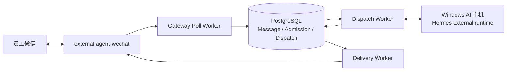
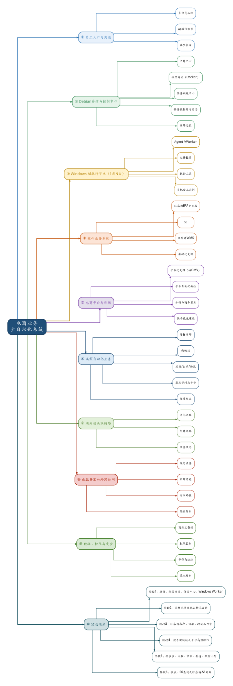

# 电商业务全自动化系统：项目总纲

- **文档版本：** V1.5
- **状态日期：** 2026-10-11
- **文档状态：** 当前基线
- **当前阶段：** 阶段 1 的企业消息 Runtime 里程碑已完成；文件基础链路仍在推进

## 总体目标

电商业务横跨微信沟通、文件收集、ERP、平台后台、仓储、物流和报表。本项目以 CFserver 为 Debian 部署宿主，以 `CF_agent-gateway` 与 PostgreSQL 为消息和控制状态权威，以 Windows AI 主机为 Agent 执行端：员工微信 → 微信入口 → Gateway 权限、上下文与任务 → 官方 Hermes 与工具 → 企业文件服务及后续业务系统 → 结果返回微信。

AI 和员工共用 FileBrowser 唯一正式文件系统。内容分类、指定目录归档、查找回传和工作副本加工后通过 API 回存，沿用 [2026-09-27 文件业务需求](./requirements/file-workflows.md)。正式原件与产物留在文件系统，AI 主机处理工作副本，默认另存新文件或新版并保留原件。

生产运行不持续依赖 GitHub 在线。消息、Checkpoint、身份、权限、路由、响应、投递、文件引用、日志和审计必须保留可恢复的权威状态。

## 当前总状态

> 文本闭环有历史生产证据；当前优先交付微信真实文件/图片收发。2026-10-11 新候选与两端新 plan 已通过但尚未切换，随后用户已重启 CFserver，重启后状态未核验。

六阶段规划中的阶段 1 原本同时包含可靠消息链与文件基础链路。FileBrowser 已有 CFserver 部署和限定读取、新建证据；完整微信附件收发、分类归档和加工回存尚未验收，因此阶段 1 与整个项目仍未完成。下一步先核验重启后现场和现存新计划，符合条件再接续切换，不从旧故障断点重新回退、传包或构建。截止点与证据分层见 [10 月 11 日摘要](./validation/records/2026-10-11-overall-status-evidence.md)。

## 四层职责

| 层级 | 组件 | 当前职责与边界 |
| --- | --- | --- |
| 员工入口 | `CF_agent-wechat` | 外部微信通道 Runtime；维护登录、读取和发送，不决定企业身份、权限或 AI 路由 |
| 消息与控制 | `CF_agent-gateway` + PostgreSQL | Poll、Checkpoint、Message、Admission、Workspace、AI Thread、V2 Routing、Dispatch、Context、Response、Delivery、日志和审计权威状态 |
| Agent 执行 | 官方 Hermes external runtime 与工具 | 在 Windows AI 主机执行 Agent、内容理解和工作副本加工；不覆盖 Gateway/PostgreSQL 权威记录 |
| 文件基础设施 | `CF_filebrowser-enterprise` | AI 和员工共用的唯一正式 File Service；已有部署与限定 API 验证，完整业务链仍待验收 |

## 带日期的组件基线

### Gateway

- `main`、修复分支、PR 和精确提交 CI 分开记录，见 [10 月 11 日摘要](./validation/records/2026-10-11-overall-status-evidence.md)；候选代码与现场镜像不能互相推导。
- [2026-09-17 长任务回传](./validation/records/2026-09-17-gateway-long-task-acceptance.md)证明该次分钟级任务的持久化与微信实收，保留其日期和限制。
- 2026-10-11 用户回传：旧两端回退、控制器 complete-rollback 与旧核心恢复均完成；新候选镜像及两端新 plan 通过，未 apply/start/verify。随后 CFserver 已 reboot，重启后运行状态未知。
- PostgreSQL、Gateway API、Poll/Dispatch/Delivery Worker 的职责与生命周期仍分开管理；历史 schema 和日志策略不作为新现场核验。

### agent-wechat

- 生产行为采用 forced fresh QR、`restart: "no"`、loopback 6174、`cf-internal`、`ENABLE_VNC=0` 和只读 Token mount。
- agent-wechat 日志策略为 `json-file 20m x 3`，不得与 Gateway 混写。
- 历史 forced-QR R2 行为有生产验证；最新媒体候选的分支、合并状态与 CI 见 [当前状态矩阵](./status/current-status.md)，候选存在不等于现场切换和附件实收通过。
- Host、container 或 Runtime 重启后需要 fresh QR；Archive 只用于证据与审计，不自动恢复为 active Session。

### Hermes

- 历史生产文本链路已经真实调用 Hermes，9 月 17 日有长任务结果回传证据。
- 10 月 6 日批准 Scope 中已存 PDF/PNG 下载后，官方 Hermes 本机 PDF 正文和辅助视觉通过限定核验；不等于完整 Agent 会话或微信入站理解、附件实收通过。
- 10 月 11 日用户只明确重启 CFserver；Windows 是否关机没有确认，不沿用历史 PID 或 reachability 作为当前状态。
- 这不表示长期 watchdog、开机自启故障、告警、容量或高可用已经完整交付。

### FileBrowser

- 9 月 26—27 日已有 CFserver 部署、受限 API、微信读取真实文件及受控新建文本的限定现场证据，不能继续标为“从未部署/接入”。
- 10 月 6 日固定集成提交 `bb11be4944b5325f2d10aa5a1adb88a3f467da72` 记录已存 PDF/PNG 的真实下载与官方原生读取；该分支未合并 main，CI 和现场验证分别列于 [10 月 11 日摘要](./validation/records/2026-10-11-overall-status-evidence.md)。
- 真实微信入站、分类归档、原聊天附件实收、工作副本加工回存及迁移、备份恢复、WebDAV/OnlyOffice 等未完成的独立验收仍保留。

## 已有历史验证的文本链路

私聊与真正结构化 `@` 机器人的群聊文本有 9 月历史闭环证据；该拓扑不表示 10 月 11 日重启后服务已恢复。未明确 `@` 的普通群消息不会调用 AI。Gateway V2 的 `group_sender` 已实现并由自动化测试覆盖 sender identity 隔离，但同群多发送者隔离尚未单独完成生产对照验收。

## 历史已完成里程碑

以下保留 9 月历史记录，具体日期见 [9 月 3 日基线](./validation/records/2026-09-03-enterprise-runtime-production-closeout.md)与 [9 月 17 日记录](./validation/records/2026-09-17-gateway-long-task-acceptance.md)，不代表本次重启后状态。

- Gateway V2 production runtime、P1 observability、不可变镜像发布和回滚证据。
- 私聊/群聊文本链、Admission、Dispatch、Response、Delivery 和 self 防回环。
- Checkpoint generation、回退/rebase、历史前缀跳过、实时后缀单次处理。
- forced fresh QR 生产行为。
- CFserver 核心服务 reboot 恢复与 fresh QR 后重新放行。
- AI 主机 reboot 后 Hermes reachability 恢复。
- Gateway-only deployment 保持 agent-wechat Session。
- Context Runtime 和 Admin recovery 的仓库实现、自动化测试和部署代码。

## 尚未完成范围

- FileBrowser 完整业务集成、生产迁移、备份恢复、回滚和客户端联调验收。
- 完整入站文件/图片理解、Hermes 多模态和出站 Artifact 回传。
- 引用正文自动注入 Hermes。
- General AI Provider routing、Skills Runtime、企业知识库/RAG。
- 旺店通、S6、寄样、库存、订单、物流、链接和报表自动化。
- PostgreSQL 实际 restore。
- agent-wechat automatic boot stop gate。
- Hermes 长期 watchdog、告警、容量和高可用。
- 生产业务权限矩阵和正式员工分批授权。
- 独立 OCR；阶段 1 按既定决定不建设。

轻量 Gateway Web 仅列待规划范围：局域网 IP 访问、Gateway 权限管理、查询 Gateway 已经接收的部分聊天与任务记录。它不承诺微信完整历史，也不复制 FileBrowser 文件权限体系。当前不并行扩安装器或做大重构。

## 设备与环境分工

| 环境 | 当前职责 |
| --- | --- |
| CFserver | Debian 物理部署宿主；承载 Gateway、PostgreSQL、external agent-wechat 与 FileBrowser，消息与业务链权威状态由 Gateway/PostgreSQL 保存；本次重启后运行状态待核验 |
| Windows AI 主机 | 承载 Hermes、后续 Skills 和 Windows 侧执行；不得用本地状态覆盖 CFserver |
| FileBrowser 正式文件环境 | 已有 CFserver 部署与限定验证；正式文件访问经唯一 File Service，完整业务验收继续分项推进 |
| 云服务器 | 后续按需提供受控入口或中转；当前不是生产消息链权威 |

## 六个建设阶段

1. **阶段 1：** 打通可靠的微信消息、身份权限、Hermes、回复投递与文件基础链路。
2. **阶段 2：** 寄样完整闭环与物流回传。
3. **阶段 3：** 旺店通库存、订单、物流与预警。
4. **阶段 4：** 快手做链接及平台高频操作。
5. **阶段 5：** 拼多多、天猫、京东、抖音、微信小店。
6. **阶段 6：** 报表、S6 查询及旺店通与 S6 对账。

阶段编号保持原定义。当前完成的是阶段 1 中的企业消息 Runtime 里程碑，剩余文件基础链路和后续业务能力按[当前进度与下一步](./status/current-progress.md)推进。

## 总体规划图

[XMind 源文件](./图表与附件/电商业务全自动化系统-总规划.xmind)与 PNG 是早期蓝图；与当前代码、生产证据或[技术决策记录](./05_技术决策记录.md)冲突时，以后者为准。

## 权威入口

- [当前状态矩阵](./status/current-status.md)
- [当前进度与下一步](./status/current-progress.md)
- [文件业务场景与实施优先级](./requirements/file-workflows.md)
- [2026-10-11 证据摘要](./validation/records/2026-10-11-overall-status-evidence.md)
- [System Architecture](./architecture/system-architecture.md)
- [Deployment Guide](./deployment/deployment-guide.md)
- [Recovery Runbook](./operations/recovery-runbook.md)
- [Production Validation Checklist](./validation/production-validation-checklist.md)
- [2026-09-03 Production Closeout](./validation/records/2026-09-03-enterprise-runtime-production-closeout.md)
- [技术决策记录](./05_技术决策记录.md)
