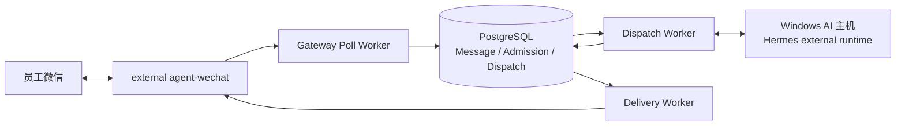

# 电商业务全自动化系统：项目总纲

- **文档版本：** V1.6
- **状态日期：** 2026-10-20
- **文档状态：** 当前基线
- **当前阶段：** 阶段 1 的企业消息 Runtime 里程碑已完成；文件基础链路仍在推进

## 总体目标

电商业务横跨微信沟通、文件收集、ERP、平台后台、仓储、物流和报表。本项目以 CFserver 为 Debian 部署宿主，以 `CF_agent-gateway` 与 PostgreSQL 为消息和控制状态权威，以 Windows AI 主机为 Agent 执行端：员工微信 → 微信入口 → Gateway 权限、上下文与任务 → 官方 Hermes 与工具 → 企业文件服务及后续业务系统 → 结果返回微信。

AI 和员工共用 FileBrowser 唯一正式文件系统。内容分类、指定目录归档、查找回传和工作副本加工后通过 API 回存，沿用 [2026-09-27 文件业务需求](./requirements/file-workflows.md)。正式原件与产物留在文件系统，AI 主机处理工作副本，默认另存新文件或新版并保留原件。

生产运行不持续依赖 GitHub 在线。消息、Checkpoint、身份、权限、路由、响应、投递、文件引用、日志和审计必须保留可恢复的权威状态。

## 当前总状态

PDF 正文读取、附件返回和样本收件摘要一致，后续文字同会话接续。**PNG图片识别及微信图片收发已验收，满足当前业务要求。** 原字节差异等历史事实保留，不再列为待修阻塞，也不归因于未定位的具体组件。

正式商品图/ZIP 工具已安装并由正式 Hermes 接口确认加载；一个商品完成 4 张主图、8 张详情归档，原包保留。查询、复制、移动、改名、替换、可恢复删除和还原有实际受限客户端/API 证据，不代表每种操作均由真实模型选择。正常微信商品 ZIP 已从企业文件系统重新导出并实收，18,167,063 字节、12 成员，整包和成员摘要匹配；不是转发刚上传原包。ZIP 入站仍未完整验收，历史超时失败、文件名前缀/中文替换及未生产验收候选继续保留。

最后现场观察为 **2026-10-19 北京时间 18:36**：收发关闭、无在途、原 Bot 登录，随后临时授权撤销、临时密码删除。本轮未重验实时状态。10 月 11 日回退、新计划未切换与重启后未知保留为历史，不再作为当前待办。精确证据见[本轮摘要](./validation/records/2026-10-20-overall-status-evidence.md)。

六阶段编号和定义不变，阶段 1 的文件基础业务已有上述限定进展，仍不能宣布阶段 1 或总体完成，不给总体百分比。一个商品不是全企业资料库；受限 API 操作不代替真实模型选工具；ZIP 出站不代替 ZIP 入站。

## 四层职责

| 层级 | 组件 | 当前职责与边界 |
| --- | --- | --- |
| 员工入口 | `CF_agent-wechat` | 外部微信通道 Runtime；维护登录、读取和发送，不决定企业身份、权限或 AI 路由 |
| 消息与控制 | `CF_agent-gateway` + PostgreSQL | Poll、Checkpoint、Message、Admission、Workspace、AI Thread、V2 Routing、Dispatch、Context、Response、Delivery、日志和审计权威状态 |
| Agent 执行 | 官方 Hermes external runtime 与工具 | 在 Windows AI 主机执行 Agent、内容理解和工作副本加工；不覆盖 Gateway/PostgreSQL 权威记录 |
| 文件基础设施 | `CF_filebrowser-enterprise` | AI 和员工共用的唯一正式 File Service；已有受限 API、单商品归档与正常微信 ZIP 出站证据；完整业务范围继续分项验收 |

## 带日期的组件基线

| 组件 | 当前可核对成果 | 边界 |
| --- | --- | --- |
| Gateway | PR19/20/21 固定源码、PDF/PNG 读取回传、同会话文字、正式商品 ZIP 实收；准确 SHA 的 CI 已核对 | 源码 HEAD、报告提交和实际运行镜像分列；ZIP 入站及真实附件续办/引用归一化不因源码包含而通过 |
| agent-wechat | 正常 PDF、PNG 图片及商品 ZIP 出站有实收证据；文件名/时区候选有构建和隔离验证 | 实际镜像不等于候选；文件名前缀/中文替换未通过原名验收，forced fresh QR 与 Archive 不复用规则保留 |
| Hermes | 官方 Hermes 有真实模型读取、分类、查询/导出与回传工具执行；正式接口确认工具加载 | 正式机器仍使用项目插件和客户端；Codex 开发模型改为 6.1 Sol 不证明生产 Hermes 模型或版本改变 |
| FileBrowser | 单商品 4 主图/8 详情归档、原包保留、实际受限 API 操作与成员完整性核验 | 非全库整理；PR4/5/6 及前置栈未合并，PR7 统一部署组件为开发验证中，常规 CI 仍有失败 |

各 PR 实际 base/head、完整 SHA、精确 CI、运行版本与镜像统一见[10 月 20 日摘要](./validation/records/2026-10-20-overall-status-evidence.md)。9 月和 10 月 11 日记录保持原日期。PostgreSQL、Gateway API、Poll/Dispatch/Delivery 的职责与生命周期仍分开管理。

## 已有历史验证的文本链路

私聊与真正结构化 `@` 机器人的群聊文本有 9 月历史闭环证据；该拓扑不证明本轮实时在线。未明确 `@` 的普通群消息不会调用 AI。Gateway V2 的 `group_sender` 已实现并由自动化测试覆盖 sender identity 隔离，但同群多发送者隔离尚未单独完成生产对照验收。

## 历史已完成里程碑

以下保留 9 月历史记录，具体日期见 [9 月 3 日基线](./validation/records/2026-09-03-enterprise-runtime-production-closeout.md)与 [9 月 17 日记录](./validation/records/2026-09-17-gateway-long-task-acceptance.md)，不代表本轮实时状态。

- Gateway V2 production runtime、P1 observability、不可变镜像发布和回滚证据。
- 私聊/群聊文本链、Admission、Dispatch、Response、Delivery 和 self 防回环。
- Checkpoint generation、回退/rebase、历史前缀跳过、实时后缀单次处理。
- forced fresh QR 生产行为。
- CFserver 核心服务 reboot 恢复与 fresh QR 后重新放行。
- AI 主机 reboot 后 Hermes reachability 恢复。
- Gateway-only deployment 保持 agent-wechat Session。
- Context Runtime 和 Admin recovery 的仓库实现、自动化测试和部署代码。

## 尚未完成范围

- FileBrowser 完整业务集成、生产迁移、备份恢复、回滚和客户端联调验收。
- ZIP 入站完整验收、更多格式/商品/会话、共享群自动归档与通用工作副本加工回存；已验收 PDF/PNG 及正常 ZIP 出站不重复列为未完成。
- 引用正文自动注入 Hermes。
- General AI Provider routing、Skills Runtime、企业知识库/RAG。
- 旺店通、S6、寄样、库存、订单、物流、链接和报表自动化。
- PostgreSQL 实际 restore。
- agent-wechat automatic boot stop gate。
- Hermes 长期 watchdog、告警、容量和高可用。
- 生产业务权限矩阵和正式员工分批授权。
- 独立 OCR；阶段 1 按既定决定不建设。

Gateway Web 仍是后续规划，不复制 FileBrowser 文件权限体系。可安排小批量资料整理和首批文件类 Skill 试点：商品资料查询/图包交付、素材归档、完整性检查；已有工具、缺规则、缺现场验收分别见[当前进度](./status/current-progress.md)。无需等待 ERP、所有部署、新 RAG 或自研 Skills Runtime；试点是后续安排，不是已交付或工期承诺。现有归档路径调整由用户明确暂缓。

项目最后安排三项：群聊会话及多人/连续消息交互；AI 按当前场景、问题和任务主动检索获准的完整聊天档案，不仅限于 Hermes 自身历史或成功任务（不等于手机微信所有历史均已采集）；Gateway 向获准人员/群聊群发消息和附件。

## 最终部署目标

服务端提供一条正式、可复用入口配合必要参数部署；电脑只安装官方 Hermes、配置少量参数，无额外项目 EXE、手工复制插件、修改 Hermes 源码或项目专用常驻进程。不依赖 Codex 工作树、`.task-artifacts`、旧现场回执；临时运维权限撤销后，正式业务使用业务凭据继续运行。

当前正式机器仍使用项目插件和客户端，新机简部署未达最终标准。另一个 Gateway 任务负责统一入口和官方 Hermes 纯配置接入，开发验证中；MCP 是验证路线：新 PR23 已验证原版官方 Hermes 纯配置远程发现、图文和隔离合成 ZIP 查询/导出，仍缺可信每任务授权绑定，未进入 Artifact/Response/微信交付；不代表完整业务或生产迁移。详见[部署指南](./deployment/deployment-guide.md)。

## 设备与环境分工

| 环境 | 当前职责 |
| --- | --- |
| CFserver | Debian 物理部署宿主；承载 Gateway、PostgreSQL、external agent-wechat 与 FileBrowser，消息与业务链权威状态由 Gateway/PostgreSQL 保存；最后现场观察仅截至 10 月 19 日 18:36，北京时间；本轮未实时核验 |
| Windows AI 主机 | 承载 Hermes、后续 Skills 和 Windows 侧执行；不得用本地状态覆盖 CFserver |
| FileBrowser 正式文件环境 | 已有 CFserver 部署、受限 API 与单商品业务证据；经唯一 File Service，完整业务范围分项验收 |
| 云服务器 | 后续按需提供受控入口或中转；当前不是生产消息链权威 |

## 六个建设阶段

1. **阶段 1：** 打通可靠的微信消息、身份权限、Hermes、回复投递与文件基础链路。
2. **阶段 2：** 寄样完整闭环与物流回传。
3. **阶段 3：** 旺店通库存、订单、物流与预警。
4. **阶段 4：** 快手做链接及平台高频操作。
5. **阶段 5：** 拼多多、天猫、京东、抖音、微信小店。
6. **阶段 6：** 报表、S6 查询及旺店通与 S6 对账。

阶段编号保持原定义。当前完成的是阶段 1 中的企业消息 Runtime 里程碑，剩余文件基础链路和后续业务能力按[当前进度与下一步](./status/current-progress.md)推进。

## 总体规划图

[XMind 源文件](./图表与附件/电商业务全自动化系统-总规划.xmind)与 PNG 是早期蓝图；与当前代码、生产证据或[技术决策记录](./05_技术决策记录.md)冲突时，以后者为准。

## 权威入口

- [当前状态矩阵](./status/current-status.md)
- [当前进度与下一步](./status/current-progress.md)
- [文件业务场景与实施优先级](./requirements/file-workflows.md)
- [2026-10-20 证据摘要](./validation/records/2026-10-20-overall-status-evidence.md)
- [System Architecture](./architecture/system-architecture.md)
- [Deployment Guide](./deployment/deployment-guide.md)
- [Recovery Runbook](./operations/recovery-runbook.md)
- [Production Validation Checklist](./validation/production-validation-checklist.md)
- [2026-09-03 Production Closeout](./validation/records/2026-09-03-enterprise-runtime-production-closeout.md)
- [技术决策记录](./05_技术决策记录.md)
