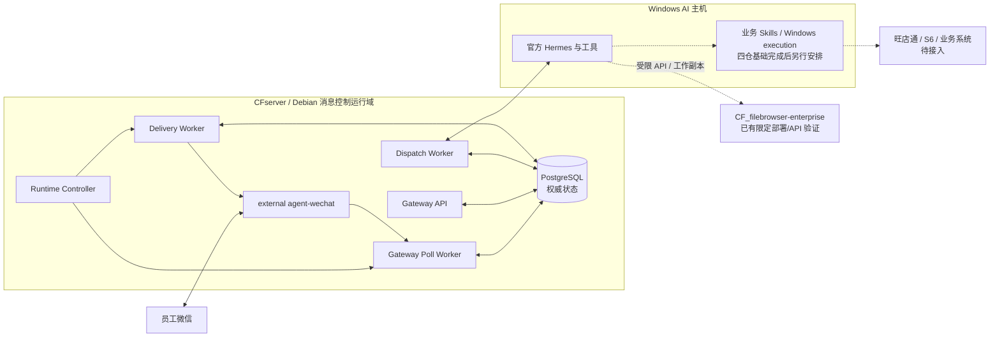
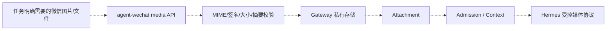

# 系统设计

> 需求同步日期：2026-10-20
>
> 最新需求以[平台基础能力与最新确认](./requirements/confirmed-platform-scope.md)为权威正文。本文同步架构影响，不表示功能已经实现。最后现场观察为 2026-10-19 北京时间 18:36，见[固定证据](./validation/records/2026-10-20-overall-status-evidence.md)；本轮未访问生产，旧验收保留原日期。

本轮实现判断来自已核实的固定代码，只读来源和远端复核边界见[需求同步记录](./validation/records/2026-10-20-requirements-sync.md)，不由本地对象推导远端最新状态或生产已部署。

## 1. 总体架构

实线表示有历史部署证据的文本链或控制关系，不表示本轮实时在线；虚线表示完整范围尚需验收。FileBrowser 已有受限文件操作、单商品归档、PDF/PNG 和正常 ZIP 出站的限定证据。agent-wechat 是外部 Compose 项目；官方 Hermes 位于按分组明确分配的目标 AI 电脑，不预设电脑数量。

## 2. 已有历史验证的文本链

1. agent-wechat 提供来源消息。
2. Poll Worker 标准化来源事实并按 Checkpoint 读取。
3. 非 self 消息先写入 PostgreSQL Message Store。
4. Gateway 完成 Source Identity Mapping、User/Gateway Policy 和 Admission。
5. Allowed 后解析 Workspace、V2 AI Thread、Agent Profile 和 Thread Policy。
6. durable Dispatch 入队后由 Dispatch Worker 调用 Hermes。
7. Hermes 结果先持久化为 Response，再形成 Delivery Outbox。
8. Delivery Worker 通过 agent-wechat 投递原会话。
9. 当前 Polling 在 sink 前跳过 self 消息，避免回环；它同时造成消息档案缺口，不能当作“全部在线消息已留档”。

Poll Worker 不直接调用 Hermes，也不内联 Delivery。Gateway API、Poll、Dispatch、Delivery 是四个独立应用进程，PostgreSQL 是第五个运行组件；external agent-wechat 另属独立项目。

## 3. 组件职责

| 组件 | 负责 | 不负责 |
| --- | --- | --- |
| `CF_agent-wechat` | 微信进程、登录状态、auth/chats/messages、来源读取和发送；已有 forced-QR 契约 | 身份权限、AI Thread、Hermes 调用、权威状态 |
| Poll Worker | Polling、Checkpoint、Message Store、Admission 触发 | Hermes 执行和结果投递 |
| Gateway API | 已有身份、策略、会话、Profile 引用、Admin 查询/恢复和 Runtime 状态；规划受控编排真实 Profile 创建/同步 | 不能将保存引用写成已创建或同步 Hermes Profile；不生成 AI 答案 |
| PostgreSQL | Message、Admission、Thread、Context、Dispatch、Response、Delivery 和恢复审计 | 长期保存大文件 Base64、接受 AI 主机状态覆盖 |
| Dispatch Worker | 领取 durable Dispatch、调用 Hermes、保存明确结果或 `uncertain` | 对结果不明盲重试 |
| Delivery Worker | 领取 Outbox、发送原会话、保存 Attempt/Receipt | 重新执行 Hermes |
| 官方 Hermes 与工具 | Agent、模型、外部配置档案、文件内容理解与工作副本加工 | 覆盖 Gateway 权威状态、绕过权限或 File Service |
| FileBrowser | 正式文件、权限、capability、WebDAV/OnlyOffice 和 Persistent Audit | 微信收发、Gateway 消息和任务编排 |

## 4. Persist-first 与 Checkpoint

- Message 持久化、Admission、Dispatch 和 Checkpoint 是独立事实。
- 首次 `LATEST` 建立高水位；恢复不得把已有环境重新视为首次 bootstrap。
- forced-QR 后 Local ID 可能回退。当前 Runtime 使用 generation、anchor、fingerprint 和 CAS 处理 rebase。
- 历史前缀作为新基线跳过，实时后缀只处理一次。
- 当前 self reply 不进入 Message/Admission/Dispatch，但推进 Checkpoint。这是现存实现；最新目标要求归档与触发分开，防回环阻止自发消息触发 AI，不应永远阻止归档。
- 无法证明连续性时 fail closed，不手工降低 Checkpoint 或清空历史。

带日期的环境计数只存在于验证记录，不是设计常量。

## 5. 身份、权限和 mention

- `enterprise_identity_id` 是内部不可变身份主键；`employee_id` 是可空业务编号。
- 来源映射使用 platform、source account 和稳定 sender ID。
- 昵称、备注、群名、纯文本 `@`、引用或上一条 mention 不能形成授权。
- 私聊不要求 mention；群聊只有结构化事实为 true 才能进入 Allowed。
- 拒绝、未 mention 和系统消息仍保留可追踪结果，但不创建 AI 工作。

最新权限顺序是先检查员工能否使用 Bot，再检查该员工能否在群聊使用 Bot。授权与分组独立，新员工可处于“已授权、未分组”；不能据此暗配默认 Profile 或自动建档。群任务由获准员工发起，其他成员发言可作为必要上下文，不能因此获得使用权限。更换分组不自动提升文件权限，正式文件授权仍由服务端执行。详见[最新确认](./requirements/confirmed-platform-scope.md)和[权限设计当前说明](./design/access-control-design.md)。

## 6. Workspace、Thread Policy 与实际实现

Physical Conversation、Employee Workspace、AI Thread、真实 Hermes Profile 和 Hermes Runtime Thread 是不同对象。真实 Profile 包含独立配置、`SOUL.md`、Skills 及相应会话/记忆状态，不能用一段提示词或普通会话 ID 替代。

### 用户已确认的 B 方案

分组提供模板，每名员工、每个微信群分别派生独立 Profile；同组员工、同组多个群均不共享具体 Profile 状态。私聊按员工分组选模板，群聊按该群分组选模板并检查发起员工权限。Profile 建立后，同一私聊/群首次建立对应会话，后续消息持续续接；不按消息、附件或任务反复建 Profile/会话。模板、具体 Profile、会话与目标电脑的关系见[权威正文](./requirements/confirmed-platform-scope.md)。

独立 Profile 不等于操作系统沙箱。新开、重置、调组后的历史、记忆、在途任务和会话如何处理仍待细化，不能默认清空、共享、迁移或重做。

### V2 已有路径与新目标差异

- `private_sender` key 包含来源、账号、物理私聊、sender identity、Profile revision 和 policy。
- `group_sender` key 包含来源、账号、物理群聊、sender identity、Profile revision 和 policy。
- `group_shared` 不包含 sender identity，只能在批准后使用。
- Gateway main 的 V2 `ThreadResolver` 与自动化测试证明同群不同 sender identity 使用不同线程。

这些是已有路由实现，不等于 B 方案。当前 `GroupType` 直接引用 `AgentProfile`，尚无模板按员工/群派生真实 Profile 的证明；`group_sender` 按发起者分线程，与“每群独立 Profile 并持续绑定该群会话”的新目标存在差异。Profile revision 参与线程键，变更模板后的会话连续性也需验证，不能直接把旧键规则沿用为新需求。

### V1 compatibility path

V1 `build_group_thread_key` 只包含 source account 和物理群聊，忽略 sender，属于 whole-room 兼容行为。历史生产使用 V2 Runtime，但 V1 代码仍存在，因此文档和运维必须显式核对 `v2_routing_enabled`，不能把 V1 行为误写成 V2 事实。

### 生产证据边界

真实群聊 `@` 文本已闭环，但现有证据没有同群两个发送者的对照记录。因此当前分类是：

- repository implemented；
- automated tests passed；
- deployed on V2 code line；
- same-group multi-sender production validation pending。

## 7. Agent Profile 与 Hermes

- Agent Profile 已保存 Gateway 路由元数据、`external_profile_ref` 和版本；现有请求携带 Profile 引用/版本及会话续接信息。
- D026“Gateway 只引用、Hermes 自行管理”保留为历史边界。本轮确认调整方向：Gateway Web 管理分组模板，并优先复用官方受控能力编排目标 Hermes 中的独立 Profile 创建与同步；可行性和接口待验证。
- 必须分别核对：保存引用及版本、请求实际进入真实 Profile、自动创建、修改/同步、已有会话何时采用新配置。请求有 Profile 字段或官方支持某接口，都不能证明后四项已经由 CF Gateway 接通并实测。
- 同步只更新管理员明确管理的模板字段；不覆盖聊天历史、已产生记忆、运行状态或独立凭据。模板字段范围、Skills 来源/版本及生效方式待细化；首次克隆不等于持续自动同步。版本、结果、失败和生效时机须可见，旧会话是否需新轮次/重载列入验证。
- Gateway Dispatch 必须带稳定 idempotency key、AI Thread、Profile、sender identity 和可用能力信息。
- 历史文本调用成功；10 月 6 日本机官方 PDF/辅助视觉通过限定核验。版本、完整 Agent 集成和运行状态按带日期证据分别判断。

完整目标与验证层次见[最新确认](./requirements/confirmed-platform-scope.md)。本轮没有创建/修改 Profile、运行实验或调用模型。

## 8. Context Runtime

Gateway main 已实现：

- 只读 Thread Timeline；
- recent/range/search；
- identity-bound authorization；
- 版本化 Context Snapshot；
- Hermes `context.read` / `context.search` 工具边界。

Timeline 只投影成功的 durable Dispatch/Response 和已解析 Artifact reference。Snapshot 是调用方提供、可重建的摘要，不覆盖原消息与响应。跨线程或跨身份读取 fail closed。

这些能力有历史自动化测试、CI 和部署代码证据；9 月生产 Closeout 未逐项演练全部读取、搜索和 Snapshot 场景。最新精确提交 CI 见[状态矩阵](./status/current-status.md)。成功任务 Timeline 不等于完整 Message 档案。当前群相关近几条消息、明确引用和明确日期范围查询属于平台基础需求，不能随高级跨会话智能检索一起后置；引用正文自动注入仍有缺口，不要求本轮建设 RAG、向量库或新 Skills Runtime。

同一私聊/群持续绑定会话，还应允许执行中的补充进入对应正在执行的过程。当前同线程 FIFO 和已有会话续接只能证明顺序与续接，不能证明运行中补充已完成。须区分当前任务补充、同会话独立新请求、动作结束或不可撤销后才到达的修改要求；官方运行中机制与 API 接入留待验证，不预设复杂合批系统。

### Message 档案与日期查询

用户要求 Bot 服务端在线期间持续采集私聊/群聊，一份 Gateway 档案支持人工 Web 查看和机器人受控查询。现有 Message 持久化、时间字段与管理查询 API 保留；self 跳过、Poll 停止/范围、上游窗口和连续性会影响完整性。Gateway 自身出站另有 Response/Delivery，但不能因此保证 Bot 其他来源自发消息全部留档。

`occurred_at`/来源 `timestamp` 是消息发生时间，`received_at` 是 Gateway 接收时间，`created_at` 是首次入库时间；管理查询主要按 `occurred_at` 和起止时间筛选。北京时间某天/月须转为明确区间，分页读取实际已归档且获准的记录；完整查询不等于把全部记录一次送入模型。轮询是采集，不是历史查询接口。机器人通过受控工具读取，不获得管理员 Token 或数据库访问权。详见[Message Store 当前说明](./design/message-store-design.md)。

## 9. Admin recovery

Gateway main 提供受认证的：

- Dispatch inspection；
- `retry-approved`；
- `mark-dead`；
- 基于持久化证据的 `confirm-success`。

恢复使用 CAS 与同事务 immutable audit，不能删除审计、手工修改 Dispatch、清空 Queue 或伪造 Response。9 月历史记录有受控恢复及 `mark-dead` 的限定证据，不证明每个 Admin 动作均已在生产演练。

## 10. Response 与 Delivery

Response、Delivery Outbox、Delivery Attempt/Receipt 分开保存。核心不变量：

- Response 未持久化不得发送。
- Delivery 失败不得重新调用 Hermes。
- 已有 Response 缺 Delivery 时走 reconciliation。
- `uncertain` 外部发送不得盲目重复。
- 文本、PDF/PNG 样本与正常 ZIP 出站已有各自带日期的通道验收；不能扩大为所有媒体或“按要求保存后独立检索交付”均完成。

## 11. 恢复目标与已有 forced-QR 契约

最新目标是故障/断电后运行一个恢复入口，检查并恢复缺失服务，微信在线时保留登录，离线时提示扫码，并分别显示采集、AI 执行和投递结果。统一恢复入口及简部署后置；不默认清 runtime、重装、升级、迁移、每次 fresh QR 或盲重做结果不明任务。已有 forced-QR 重启契约与“在线保留登录”存在冲突，以下保留为已有实现事实，尚未通过新目标验收。本轮不修改运行脚本。

### Host/container/Runtime restart

agent-wechat 使用 `restart: "no"`。CFserver reboot、container recreate 或 Runtime restart 后不自动恢复；必须归档旧 Runtime 并执行 fresh QR。Archive 不得挂回 active Session。

9 月历史 CFserver reboot 中 Gateway 核心恢复、agent-wechat 保持停止，但 Poll/Delivery 当时被观察为 running/healthy。因此 automatic boot stop gate 未验证；fresh QR 前必须通过 Runtime Controller `stop` 关闭组合 Poll/Delivery Gate。验证完成后，Controller `start` 同时准备、重建并启动两个受控 Worker。Dispatch Worker 不受 Controller 管理，可在组合 Gate 关闭时保持在线。

10 月 11 日旧回退与重启未知状态保留在[当日历史记录](./validation/records/2026-10-11-overall-status-evidence.md)，不再作为当前操作断点。最后实际现场观察截至 10 月 19 日北京时间 18:36，见[10 月 20 日固定证据](./validation/records/2026-10-20-overall-status-evidence.md)；本轮没有实时复核或执行恢复。

### AI host restart

CFserver 和 agent-wechat 不重启时微信 Session 保持，不需要 fresh QR。AI 主机恢复后必须核对 Hermes reachability、Controller 和 Queue。一次成功恢复不等于长期 watchdog/HA。

### Gateway-only deployment

不重建 agent-wechat 的 Gateway-only cutover 保持 authenticated Session，不需要 fresh QR。

## 12. Media Runtime 目标边界

### 入站

消息/附件元数据留档、任务临时取得原件、正式文件库归档是三个动作。普通附件没有任务时一般不处理、不回复，不自动下载并永久归档；明确请求查看/处理才按任务取得，明确“存起来”才经 File Service 保存。纯文档群可按明确配置自动收件/保存。已有媒体能力、PDF/PNG 样本和正常 ZIP 出站保留各自证据；ZIP 入站缺口、合法原文件名协议部署与收件验收未完成的边界继续保留。文件名是基础通道问题，不能降为提示词优化。

### 出站

图示表达 D028 的受控取得字节、原子物化与 READY 边界，具体下载或任务内上传交接协议以固定候选代码为准，不将旧下载示意限定为唯一取件方式。Gateway 仓库中的 Artifact/媒体数据结构和测试不能替代系统级集成与真实微信投递证据。

## 13. File Service 与 Skills

- Gateway 私有媒体存储只服务短期中转。
- AI 和员工共用 `CF_filebrowser-enterprise` 唯一正式文件系统。9 月 26—27 日已有部署、受限读取和新建文本证据；10 月 6 日有已存 PDF/PNG 真实下载与本机理解证据，完整微信文件业务仍待验收。
- 按明确任务取得、检索、保存与回传，沿用[文件业务需求](./requirements/file-workflows.md)最新确认。正式文件经 File Service API、权限与审计读写，工作副本在 AI 主机处理；无明确要求不覆盖原件或自动归档派生稿。
- 微信入站取得字节、内容理解、归档、查询回传、原聊天附件实收和加工结果回存分别验收；不以 HTTP 200、文本新建、CI 或读取成功替代。
- FileBrowser 迁移、备份恢复、回滚和真实 WebDAV/OnlyOffice 联调继续保留独立验收边界。
- Skills、旺店通、S6 和企业知识库均通过虚线边界保留，不能画成当前生产实线。
- 商品别名、分类细节、手卡内容匹配、模板填充和业务流程交给后续 Hermes/Skills。四仓基础完成后用户另找 Hermes 制作 Skills，并另建仓库；此前并行首批 Skill 试点安排已调整，不在本轮制作 Skill 或新建 Runtime/RAG。
- 取消“AI 主机关机后先收所有原件、开机自动补分类”当前专项，保留消息/已取得文件/任务状态持久化及防重原则。离线请求提示、结束或保留待处理仍待细化，不默认次日自动执行积压业务。
- 第一阶段不建设独立 OCR。

## 14. 核心数据对象

| 数据对象 | 当前用途 |
| --- | --- |
| Message / Raw Payload / Checkpoint | 来源事实、连续性与幂等 |
| Identity / Mapping / Access Policy | 身份、允许范围与 Admission |
| Workspace / AI Thread / Route Snapshot | 上下文归属与 V2 路由 |
| Context Entry / Snapshot | 授权线程 Timeline 与派生摘要 |
| Dispatch / Recovery Audit | Hermes 执行、租约、结果不明和受控恢复 |
| Response / Delivery / Receipt | 生成结果与渠道投递 |
| Attachment / Artifact | 保留已有实现与 PDF/PNG、正常 ZIP 出站限定验收；通用入站、原文件名和任务关联仍分项记录 |

表结构、索引和 migration 由组件仓库管理；本文只定义系统级边界。

## 15. 当前恢复不变量

1. 未持久化的员工消息不得进入执行。
2. 拒绝不删除消息。
3. 结果不明不自动重做。
4. 已有 Response 时不得重跑 Hermes；先诊断 Delivery。若需重启受控 Worker，通过组合 Poll/Delivery Gate 同时恢复二者。
5. 非 READY Artifact 不得投递。
6. fresh QR 前关闭 Gate。
7. Archive 不恢复为 active Session。
8. 不跨项目执行 `docker compose down` 或 `--remove-orphans`。
9. 不删除数据库行、手工改 Checkpoint、清空 Queue 或打印 Secret。

## 16. Gateway Web 与分组分机：已确认规划

Web 后续管理员工 Bot/群聊使用权限、员工/群分组、模板与 B 方案派生 Profile 的创建/同步版本和目标电脑、微信登录及采集/执行/投递状态、已采集聊天查询、电脑与运行/排队任务和实际资源、员工/群/组使用频率。已有身份/策略/Profile 数据与读取 API、Message/任务/心跳状态基础保留；仍缺管理写接口闭环、Profile 编排、资源/频率等数据采集及页面，不能统称“后台全好只差 Web”。逐项实现/缺口分类见[权威需求正文](./requirements/confirmed-platform-scope.md)。

按部门、岗位或业务分组，再由 Web 明确配置分组任务到哪些电脑，独立员工/群 Profile 部署在相应目标电脑。电脑数量取决于人数、频率和资源需要；当前采用可观察、可手工配置分配。CPU/内存和频率展示为后续方向，不预设 UI 任务必须另一台电脑，也不把自动阈值、复杂负载均衡或执行中迁移列为已确认必做。会话/任务/电脑映射和分配变更生效方式须可见，不默认丢历史、重复执行或无声切换。权限在正式服务端执行，日常员工增删目标是管理操作便捷，不固化为 SSH/SQL 手工流程。

当前状态见[状态矩阵](./status/current-status.md)，固定现场截止点见[2026-10-20 证据摘要](./validation/records/2026-10-20-overall-status-evidence.md)；PR12 稍后形成的纯配置候选与实验结果见[候选证据](./validation/records/2026-10-20-configuration-only-candidate.md)。旧验收保留原日期和失败事实，候选不等于生产迁移或新机/整机重启已证明。
