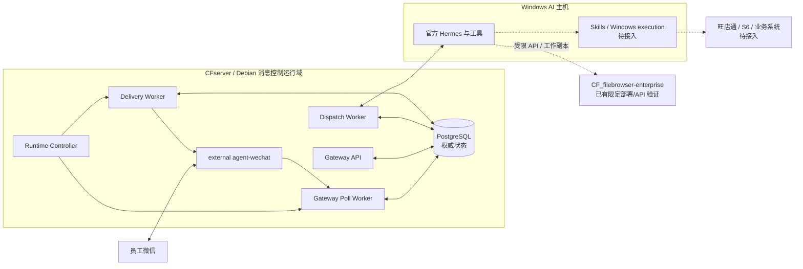
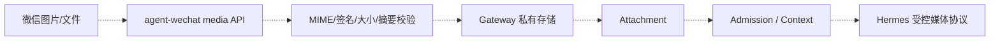
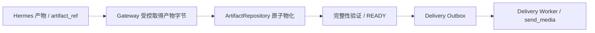

# 系统设计

> 状态日期：2026-10-11
>
> 本文描述已有历史验证的文本链、文件服务限定集成和仍待完整验收的文件业务边界。代码/CI 与现场分开记录；10 月 11 日 CFserver 重启后状态未知，见 [证据摘要](./validation/records/2026-10-11-overall-status-evidence.md)。

## 1. 总体架构

实线表示有历史部署证据的文本链或控制关系，不表示本次重启后已在线；虚线表示尚未完成整体业务验收的集成。FileBrowser 已有受限 API 读取/新建及本机 PDF/PNG 理解证据。agent-wechat 是外部 Compose 项目，不是 Gateway 内部模块；官方 Hermes 位于 Windows AI 主机，不是 CFserver 服务。

## 2. 已有历史验证的文本链

1. agent-wechat 提供来源消息。
2. Poll Worker 标准化来源事实并按 Checkpoint 读取。
3. 非 self 消息先写入 PostgreSQL Message Store。
4. Gateway 完成 Source Identity Mapping、User/Gateway Policy 和 Admission。
5. Allowed 后解析 Workspace、V2 AI Thread、Agent Profile 和 Thread Policy。
6. durable Dispatch 入队后由 Dispatch Worker 调用 Hermes。
7. Hermes 结果先持久化为 Response，再形成 Delivery Outbox。
8. Delivery Worker 通过 agent-wechat 投递原会话。
9. Bot self reply 被 Polling 受控跳过，避免回环。

Poll Worker 不直接调用 Hermes，也不内联 Delivery。Gateway API、Poll、Dispatch、Delivery 是四个独立应用进程，PostgreSQL 是第五个运行组件；external agent-wechat 另属独立项目。

## 3. 组件职责

| 组件 | 负责 | 不负责 |
| --- | --- | --- |
| `CF_agent-wechat` | forced QR、微信进程、auth/chats/messages、来源读取和发送 | 身份权限、AI Thread、Hermes 调用、权威状态 |
| Poll Worker | Polling、Checkpoint、Message Store、Admission 触发 | Hermes 执行和结果投递 |
| Gateway API | 身份、策略、会话、Profile、Admin 查询/恢复和 Runtime 状态 | 创建 Hermes 内部 Profile、生成 AI 答案 |
| PostgreSQL | Message、Admission、Thread、Context、Dispatch、Response、Delivery 和恢复审计 | 长期保存大文件 Base64、接受 AI 主机状态覆盖 |
| Dispatch Worker | 领取 durable Dispatch、调用 Hermes、保存明确结果或 `uncertain` | 对结果不明盲重试 |
| Delivery Worker | 领取 Outbox、发送原会话、保存 Attempt/Receipt | 重新执行 Hermes |
| 官方 Hermes 与工具 | Agent、模型、外部配置档案、文件内容理解与工作副本加工 | 覆盖 Gateway 权威状态、绕过权限或 File Service |
| FileBrowser | 正式文件、权限、capability、WebDAV/OnlyOffice 和 Persistent Audit | 微信收发、Gateway 消息和任务编排 |

## 4. Persist-first 与 Checkpoint

- Message 持久化、Admission、Dispatch 和 Checkpoint 是独立事实。
- 首次 `LATEST` 建立高水位；恢复不得把已有环境重新视为首次 bootstrap。
- forced-QR 后 Local ID 可能回退。当前 Runtime 使用 generation、anchor、fingerprint 和 CAS 处理 rebase。
- 历史前缀作为新基线跳过，实时后缀只处理一次。
- self reply 不进入 Message/Admission/Dispatch，但推进 Checkpoint。
- 无法证明连续性时 fail closed，不手工降低 Checkpoint 或清空历史。

带日期的环境计数只存在于验证记录，不是设计常量。

## 5. 身份、权限和 mention

- `enterprise_identity_id` 是内部不可变身份主键；`employee_id` 是可空业务编号。
- 来源映射使用 platform、source account 和稳定 sender ID。
- 昵称、备注、群名、纯文本 `@`、引用或上一条 mention 不能形成授权。
- 私聊不要求 mention；群聊只有结构化事实为 true 才能进入 Allowed。
- 拒绝、未 mention 和系统消息仍保留可追踪结果，但不创建 AI 工作。

## 6. Workspace、Thread Policy 与实际实现

Physical Conversation、Employee Workspace、AI Thread 和 Hermes Runtime Thread 是四个不同对象。

### V2 当前路径

- `private_sender` key 包含来源、账号、物理私聊、sender identity、Profile revision 和 policy。
- `group_sender` key 包含来源、账号、物理群聊、sender identity、Profile revision 和 policy。
- `group_shared` 不包含 sender identity，只能在批准后使用。
- Gateway main 的 V2 `ThreadResolver` 与自动化测试证明同群不同 sender identity 使用不同线程。

### V1 compatibility path

V1 `build_group_thread_key` 只包含 source account 和物理群聊，忽略 sender，属于 whole-room 兼容行为。历史生产使用 V2 Runtime，但 V1 代码仍存在，因此文档和运维必须显式核对 `v2_routing_enabled`，不能把 V1 行为误写成 V2 事实。

### 生产证据边界

真实群聊 `@` 文本已闭环，但现有证据没有同群两个发送者的对照记录。因此当前分类是：

- repository implemented；
- automated tests passed；
- deployed on V2 code line；
- same-group multi-sender production validation pending。

## 7. Agent Profile 与 Hermes

- Agent Profile 保存 Gateway 路由元数据和 `external_profile_ref`。
- Hermes 自行创建和管理配置档案。
- Profile revision 变化可以形成新的 V2 Thread generation。
- Gateway Dispatch 必须带稳定 idempotency key、AI Thread、Profile、sender identity 和可用能力信息。
- 历史文本调用成功；10 月 6 日本机官方 PDF/辅助视觉通过限定核验。版本、完整 Agent 集成和本次重启后状态按带日期证据分别判断。

## 8. Context Runtime

Gateway main 已实现：

- 只读 Thread Timeline；
- recent/range/search；
- identity-bound authorization；
- 版本化 Context Snapshot；
- Hermes `context.read` / `context.search` 工具边界。

Timeline 只投影成功的 durable Dispatch/Response 和已解析 Artifact reference。Snapshot 是调用方提供、可重建的摘要，不覆盖原消息与响应。跨线程或跨身份读取 fail closed。

这些能力有历史自动化测试、CI 和部署代码证据；9 月生产 Closeout 未逐项演练全部读取、搜索和 Snapshot 场景。最新精确提交 CI 见 [状态矩阵](./status/current-status.md)，不由历史绿灯推导。RAG、向量库、长期 Memory 与引用正文自动注入仍未完成。

## 9. Admin recovery

Gateway main 提供受认证的：

- Dispatch inspection；
- `retry-approved`；
- `mark-dead`；
- 基于持久化证据的 `confirm-success`。

恢复使用 CAS 与同事务 immutable audit，不能删除审计、手工修改 Dispatch、清空 Queue 或伪造 Response。9 月历史记录有受控恢复及 `mark-dead` 的限定证据，不证明每个 Admin 动作均已在生产演练。

## 10. Response 与 Delivery

Response、Delivery Outbox、Delivery Attempt/Receipt 分开保存。核心不变量：

- Response 未持久化不得发送。
- Delivery 失败不得重新调用 Hermes。
- 已有 Response 缺 Delivery 时走 reconciliation。
- `uncertain` 外部发送不得盲目重复。
- 文本链有带日期的历史生产验证；完整媒体投递和原聊天实际附件实收未完成。

## 11. forced-QR 与重启

### Host/container/Runtime restart

agent-wechat 使用 `restart: "no"`。CFserver reboot、container recreate 或 Runtime restart 后不自动恢复；必须归档旧 Runtime 并执行 fresh QR。Archive 不得挂回 active Session。

9 月历史 CFserver reboot 中 Gateway 核心恢复、agent-wechat 保持停止，但 Poll/Delivery 当时被观察为 running/healthy。因此 automatic boot stop gate 未验证；fresh QR 前必须通过 Runtime Controller `stop` 关闭组合 Poll/Delivery Gate。验证完成后，Controller `start` 同时准备、重建并启动两个受控 Worker。Dispatch Worker 不受 Controller 管理，可在组合 Gate 关闭时保持在线。

10 月 11 日旧两端回退、complete-rollback 与旧核心恢复已完成，新候选与两端新 plan 通过但尚未切换。用户随后明确已重启 CFserver；重启后 Gate、登录与服务状态未核验，Windows 是否关机没有确认。下一步核验现场和现存计划后接续，不重放已完成回退或沿用历史 PID，详见 [现场截止点](./validation/records/2026-10-11-overall-status-evidence.md)。

### AI host restart

CFserver 和 agent-wechat 不重启时微信 Session 保持，不需要 fresh QR。AI 主机恢复后必须核对 Hermes reachability、Controller 和 Queue。一次成功恢复不等于长期 watchdog/HA。

### Gateway-only deployment

不重建 agent-wechat 的 Gateway-only cutover 保持 authenticated Session，不需要 fresh QR。

## 12. Media Runtime 目标边界

### 入站

入站附件、下载与内容读取已有候选代码和隔离测试，具体合并状态见 [状态矩阵](./status/current-status.md)。FileBrowser 已存 PDF/PNG 的下载及本机理解不等于微信上游已取得真实附件；完整微信入站持久化、Agent 内容理解和类型兼容性仍须分项实机验收。

### 出站

图示表达 D028 的受控取得字节、原子物化与 READY 边界，具体下载或任务内上传交接协议以固定候选代码为准，不将旧下载示意限定为唯一取件方式。Gateway 仓库中的 Artifact/媒体数据结构和测试不能替代系统级集成与真实微信投递证据。

## 13. File Service 与 Skills

- Gateway 私有媒体存储只服务短期中转。
- AI 和员工共用 `CF_filebrowser-enterprise` 唯一正式文件系统。9 月 26—27 日已有部署、受限读取和新建文本证据；10 月 6 日有已存 PDF/PNG 真实下载与本机理解证据，完整微信文件业务仍待验收。
- 内容分类、指定目录归档、查找回传与工作副本加工后 API 回存沿用 [文件业务需求](./requirements/file-workflows.md)。正式文件经 File Service API 读写，工作副本在 AI 主机处理，默认保留原件并另存产物。
- 微信入站取得字节、内容理解、归档、查询回传、原聊天附件实收和加工结果回存分别验收；不以 HTTP 200、文本新建、CI 或读取成功替代。
- FileBrowser 迁移、备份恢复、回滚和真实 WebDAV/OnlyOffice 联调继续保留独立验收边界。
- Skills、旺店通、S6 和企业知识库均通过虚线边界保留，不能画成当前生产实线。
- 第一阶段不建设独立 OCR。

## 14. 核心数据对象

| 数据对象 | 当前用途 |
| --- | --- |
| Message / Raw Payload / Checkpoint | 来源事实、连续性与幂等 |
| Identity / Mapping / Access Policy | 身份、允许范围与 Admission |
| Workspace / AI Thread / Route Snapshot | 上下文归属与 V2 路由 |
| Context Entry / Snapshot | 授权线程 Timeline 与派生摘要 |
| Dispatch / Recovery Audit | Hermes 执行、租约、结果不明和受控恢复 |
| Response / Delivery / Receipt | 生成结果与渠道投递 |
| Attachment / Artifact | 部分仓库实现存在；系统级媒体闭环未完成 |

表结构、索引和 migration 由组件仓库管理；本文只定义系统级边界。

## 15. 当前恢复不变量

1. 未持久化的员工消息不得进入执行。
2. 拒绝不删除消息。
3. 结果不明不自动重做。
4. 已有 Response 时不得重跑 Hermes；先诊断 Delivery。若需重启受控 Worker，通过组合 Poll/Delivery Gate 同时恢复二者。
5. 非 READY Artifact 不得投递。
6. fresh QR 前关闭 Gate。
7. Archive 不恢复为 active Session。
8. 不跨项目执行 `docker compose down` 或 `--remove-orphans`。
9. 不删除数据库行、手工改 Checkpoint、清空 Queue 或打印 Secret。

## 16. 轻量 Gateway Web：规划边界

后续可规划局域网 IP 访问、Gateway 权限管理，以及查询 Gateway 已经接收的部分聊天/任务记录。它是 Gateway 状态与授权的管理入口，不承诺微信完整历史，不复制 FileBrowser 文件权限体系。本轮不开发，当前不并行扩安装器或做大重构。

当前状态见[状态矩阵](./status/current-status.md)，最新截止点见[2026-10-11 证据摘要](./validation/records/2026-10-11-overall-status-evidence.md)；[2026-09-03 Production Closeout](./validation/records/2026-09-03-enterprise-runtime-production-closeout.md)和 [2026-09-17 长任务回传](./validation/records/2026-09-17-gateway-long-task-acceptance.md)保留为历史限定证据。
