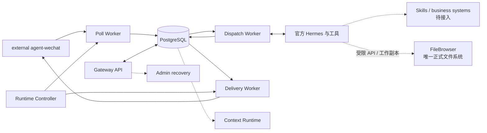

# 组件职责图谱

> 状态日期：2026-10-11。以下职责与带日期能力不表示当前在线；用户已重启 CFserver，重启后现场尚未核验。完整 SHA、PR、精确 CI 和实机截止点见 [证据摘要](../validation/records/2026-10-11-overall-status-evidence.md)。

| 组件 | Repository implementation | Deployment / validation | Remaining boundary |
| --- | --- | --- | --- |
| Gateway API | 身份、策略、Profile、Admin 和 Runtime health 已实现；新候选未合并状态见证据摘要 | 历史文本控制链通过；10 月 11 日旧核心恢复完成，新候选未切换 | 重启后核验、完整管理面与所有恢复动作 |
| Poll Worker | Polling、Checkpoint generation/rebase、Persist-first 已实现 | 历史 forced-QR 连续性有证据；10 月 11 日重启前停止 | 重启后核验、长期窗口和历史连续性残余问题 |
| Dispatch Worker | durable Dispatch、Hermes、FIFO、`uncertain` 已实现 | 9 月 17 日分钟级文本回传通过；10 月 11 日重启前旧 Dispatch 运行 | 重启后核验、媒体和长期容量 |
| Delivery Worker | durable Outbox、Attempt、Receipt、reconciliation 已实现 | 历史文本投递通过；10 月 11 日重启前停止 | 原聊天实际附件实收待验收 |
| PostgreSQL | 历史 schema `20260823_04`；权威消息与任务状态 | 10 月 11 日重启前用户回传正常，重启后未知 | 新现场核验与 restore 演练 |
| Runtime Controller | v1 组合 stop/start Poll Worker 与 Delivery Worker；不控制 Dispatch | 10 月 11 日 complete-rollback 完成、重启前 Gate 关闭 | 重启后重新检查 Gate；automatic boot stop gate 未验收 |
| external agent-wechat | 媒体候选与 main、PR、CI 分开记录 | 历史 forced-QR 和文本有证据；新候选未完成切换与媒体实收验收 | 新现场登录/Gate、来源映射与媒体闭环 |
| 官方 Hermes 与工具 | 外部服务；文件读取/工作副本能力按固定版本和调用边界记录 | 历史文本通过；10 月 6 日本机 PDF/真实辅助视觉通过；10 月 11 日 Windows 是否关机未知 | 完整 Agent 文件业务与 watchdog、告警、容量、HA |
| Context Runtime | Timeline、Snapshot、search 和授权读取 | 历史实现/测试/部署代码证据 | 全能力生产演练、RAG/Memory |
| Admin recovery | inspect、retry-approved、mark-dead、confirm-success | 历史实现/测试与限定现场恢复证据 | 每种动作生产演练 |
| Media Runtime | 入站/出站与内容读取有候选代码和隔离测试，分支状态见证据摘要 | 历史图片字节及本机读取不替代微信附件闭环 | 入站字节、理解、归档、查询回传、原聊天实收、加工回存分别验收 |
| FileBrowser | 唯一正式 File Service；集成 `bb11be4…` 未合并 main，专项 CI 与 regular 失败分开记录 | 9 月 26—27 日部署/受限读写；10 月 6 日已存 PDF/PNG 下载与本机理解 | 完整微信文件业务、迁移/restore、WebDAV/OnlyOffice |
| Skills / 旺店通 / S6 | 未接入 | 未部署、未验证 | 后续实施 |
| 轻量 Gateway Web | 待规划 | 未开发/未验收 | 局域网 IP、Gateway 权限、已接收部分聊天/任务查询；不承诺微信完整历史，不复制文件权限 |

图示不表示本次重启后在线；文件业务完整链尚待验收。AI 与员工共用 FileBrowser，正式访问经其 API、权限与审计，Gateway 私有媒体只做受控中转。内容分类、指定目录归档、查找回传及加工回存沿用 [9 月 27 日业务需求](../requirements/file-workflows.md)。正式状态以[当前状态矩阵](../status/current-status.md)为准。
