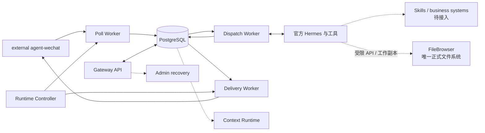

# 组件职责图谱

> 需求同步日期：2026-10-20。最后现场观察为 10 月 19 日北京时间 18:36；本轮未实时核验。固定 SHA、PR、CI 和现场边界见[总体证据](../validation/records/2026-10-20-overall-status-evidence.md)与[PR12 后续候选证据](../validation/records/2026-10-20-configuration-only-candidate.md)。

| 组件 | Repository implementation | Deployment / validation | Remaining boundary |
| --- | --- | --- | --- |
| Gateway API | 身份/策略/Profile 引用等数据库与读取 API、Admin 恢复及 health 有基础 | 历史文本控制链有证据；精确候选与部署分别记录 | 员工群聊权限、分组/模板管理写接口、B 方案 Profile 编排和 Web |
| Poll Worker | Polling、Checkpoint generation/rebase、Persist-first | 历史 forced-QR 连续性有证据 | self 跳过、Poll 停止/范围、上游窗口与连续性造成档案缺口 |
| Dispatch Worker | durable Dispatch、Hermes 会话续接、FIFO、`uncertain` | 9 月 17 日分钟级文本回传通过，后续文件通道另留证 | FIFO 不等于执行中补充；B 方案群持续会话和分组分机待接通 |
| Delivery Worker | durable Outbox、Attempt、Receipt、reconciliation | PDF/PNG 样本及正常 ZIP 出站已有限定实收 | 原文件名实际协议部署/收件验收、其他文件场景分项补齐 |
| PostgreSQL | 权威 Message/Admission/Dispatch/Response/Delivery 与持久化 | 历史 schema 和现场证据各按日期 | restore 演练；保留原持久化/防重原则，不因取消离线分类而废弃 |
| Runtime Controller | v1 组合 stop/start Poll Worker 与 Delivery Worker；不控制 Dispatch | 历史受控恢复和 Gate 证据 | 统一恢复入口后置；旧 forced-QR 与在线保留登录目标冲突，未改实现 |
| external agent-wechat | 微信读取、登录、媒体通道与候选各按 SHA 记录 | 历史文本、PDF/PNG 和正常 ZIP 出站各有证据 | ZIP 入站、合法原文件名、采集连续性；未重做现场核验 |
| 官方 Hermes 与工具 | 外部 Agent/文件工具；已有 Profile 引用/会话请求基础 | 历史文本、PDF/PNG 理解及隔离官方纯配置实验 | 真实 Profile 路由/创建/同步/旧会话生效逐项待验证，可信任务关联仍缺 |
| Context Runtime | 成功任务 Timeline、Snapshot、search 和授权读取 | 历史实现/测试/部署代码证据 | 当前群 Message 上文、引用、日期查询工具接入；高级跨会话检索后置 |
| Admin recovery | inspect、retry-approved、mark-dead、confirm-success | 历史实现/测试与限定现场恢复证据 | 每种动作生产演练 |
| Media Runtime | 任务取件、READY Artifact 等已有实现/候选和隔离验证 | PDF/PNG 样本、正常 ZIP 出站通道已验收 | 取件、正式保存、独立检索交付分别判断；不自动下载永久归档所有附件 |
| FileBrowser | 唯一正式 File Service；受限查询/读写及文件操作基础保留 | 单商品归档、原包保留、正常 ZIP 导出已有证据；CI 失败保留 | 通用文件业务、迁移/restore、WebDAV/OnlyOffice 及完整关联审计 |
| Skills / 旺店通 / S6 | 具体业务理解/流程后续承接 | 未作为本轮交付 | 四仓基础完成后用户另找 Hermes 制作并另建 Skills 仓库；不并行试点 |
| Gateway Web | 七项管理展示方向已确认；已有部分数据库/读取 API | 页面未开发；CPU/内存/频率采集尚缺 | 管理写接口、B 方案状态、资源/频率采集与页面分开，不称后台全完成 |

图示不表示本轮实时在线。AI 与员工共用 FileBrowser，正式访问经其 API、权限与审计，Gateway 私有媒体只做受控中转。分组模板派生每员工/群独立 Profile，再按组明确分配目标电脑；机器数与变更规则不预设。完整关系见[最新权威确认](../requirements/confirmed-platform-scope.md)，文件触发见[文件业务需求](../requirements/file-workflows.md)，事实见[当前状态矩阵](../status/current-status.md)。
