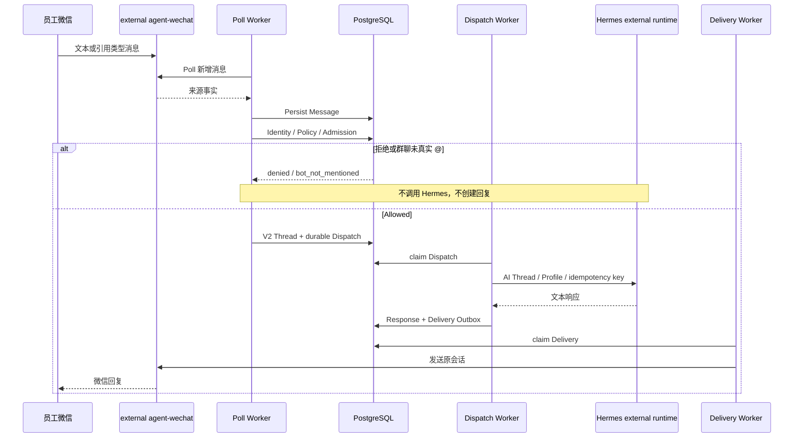
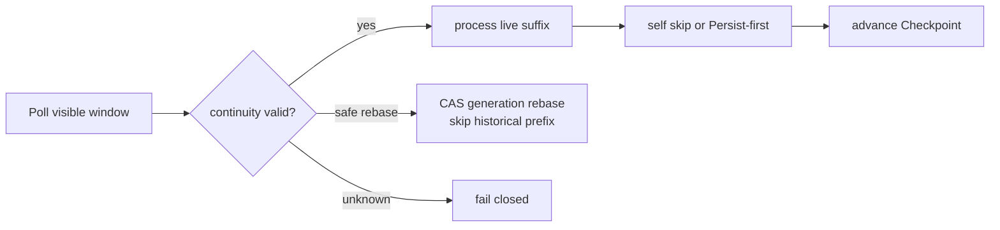
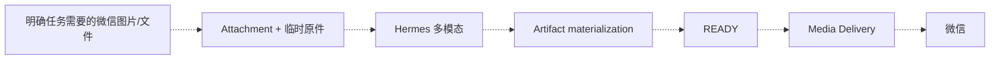

# 消息与任务流程

> 需求同步日期：2026-10-20；已有流程与历史验收保留原边界，本轮未访问生产。

## 已有文本流程

Poll Worker 在 durable Dispatch 入队后结束该消息的入站处理，不直接调用 Hermes。Delivery Worker 也不内联于 Poll Worker。

## Thread Policy

| 场景 | 当前实现 | 生产证据 |
| --- | --- | --- |
| 私聊 | V2 `private_sender` | 文本闭环通过 |
| 群聊真实 `@` | V2 `group_sender`，key 包含 sender identity | 单一群聊闭环通过；同群多发送者隔离未单独验收 |
| 群聊未 `@` | `bot_not_mentioned` | 不调用 AI 已验证 |
| `group_shared` | 代码支持，默认不启用 | 未批准、未生产验证 |
| V1 compatibility | whole-room group thread | 不得当作 V2 生产策略 |

最新 B 方案是每员工/每群独立真实 Hermes Profile，分组是模板，私聊按员工组、群聊按群组且校验发起员工权限。同一私聊/群首次建立对应会话后持续续接。表中 `group_sender` 按发起者分线程及 revision 改键是已有实现，与新目标有差距，不能把 `group_shared` 代码存在写成已经完成 B 方案。Gateway 保存/携带 Profile 引用不证明真实 Profile 路由、创建、同步和旧会话生效，详见[最新确认](../requirements/confirmed-platform-scope.md)。

同线程 FIFO 和会话续接不等于执行中补充。用户要求当前任务补充能进入对应正在执行的过程；同会话新请求和已结束/不可撤销动作后的修改须分别处理。官方机制及 API 接入待验证，本轮不实验、不预定合批系统。

## Checkpoint 流程

forced-QR 后的 Local ID 回退、generation、历史前缀跳过、实时后缀单次处理、self skip 和无重复回复已经生产验证。

该历史防回环证据不等于完整档案。当前 self 在 sink 前跳过，Gateway 自身出站另存 Response/Delivery，Bot 其他来源自发消息不能据此保证留档。新目标要求在线期间持续采集私聊/群聊，未 `@` 可留档而不触发 AI；Poll 停止/范围、上游窗口和连续性仍会限制完整性。档案同时服务人工 Web 和机器人受控查询，查询日期范围读取已归档记录，不重新轮询微信历史。

## 引用消息

引用结构和 `reply_context` 已保存，引用类型文本可以完成回复。群聊引用不替代真实 mention；被引用正文尚未自动注入 Hermes。

当前群相关近几条消息、明确引用及日期范围查询是基础需求。现有 Context 工具只投影成功 Dispatch/Response，不能代表未 `@` 群消息上文已接通；高级跨会话完整档案智能检索继续后置。日期查询按北京时间转换明确范围并分页读取实际已存且获准记录，不一次把全部内容送模型。时间含义与权限见[Message Store 当前说明](../design/message-store-design.md)。

## 媒体与文件目标流程

虚线表示完整范围仍有缺口；保留已有 PDF/PNG 样本与正常 ZIP 出站验收，ZIP 入站、原文件名收件和任务关联等分别记录。普通附件默认不主动处理/回复；消息/附件元数据留档、按任务取得原件、正式归档三者分开。“存起来”才经 File Service 归档，纯文档群明确配置可自动收件。PNG 图片业务已被用户接受，不再追查原字节差异。详见[文件业务需求](../requirements/file-workflows.md)。

## 失败与恢复

- Message 未持久化：不执行、不推进。
- `uncertain` Dispatch：使用 Admin inspection 和审计恢复，不盲重试。
- 已有 Response、缺 Delivery：只做 reconciliation，不再次调用 Hermes。
- 已有契约下 agent-wechat stopped/logged_out：关闭组合 Poll/Delivery Gate 后 fresh QR，验证 API 再恢复两个受控 Worker；Dispatch Worker 独立管理。这是既有操作边界，本轮不执行。
- Gateway-only deployment：不重建 agent-wechat，不需要 fresh QR。
- AI host reboot：不重启微信 Session，恢复后核对 Hermes reachability。

最新恢复目标是统一入口检查/恢复缺失服务，微信在线保留登录、离线再提示扫码，并给出采集/执行/投递结果；与旧每次重启 forced-QR 存在冲突，留待后续实现，不改历史验收。简部署/恢复后置，不盲重做结果不明任务。

状态与固定证据见[当前状态矩阵](../status/current-status.md)和[2026-10-20 总体证据](../validation/records/2026-10-20-overall-status-evidence.md)，本轮不是现场核验。
