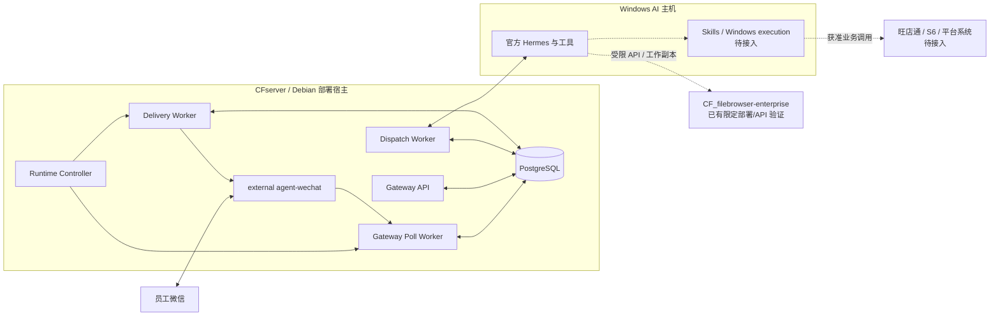

# System Architecture

> 中文名称：企业自动化系统总体架构
>
> 文档编号：ARC-001
>
> 文档状态：当前基线
>
> 状态日期：2026-10-11

## 1. 当前结论

整体目标是员工微信 → 微信入口 → Gateway 权限、上下文与任务 → 官方 Hermes 与工具 → 企业文件服务及后续业务系统 → 结果返回微信。AI 和员工共用 FileBrowser 唯一正式文件系统，文件场景沿用 [9 月 27 日业务需求](../requirements/file-workflows.md)。

文本闭环保留 9 月历史证据；FileBrowser 已有部署与限定读取、新建及本机 PDF/PNG 理解证据。当前优先微信真实文件/图片收发，完整业务闭环未验收。10 月 11 日新候选与两端新计划通过但尚未切换，用户随后重启 CFserver，重启后状态未知；下一步先核验现场和现存计划，符合条件再接续。详见 [最新证据摘要](../validation/records/2026-10-11-overall-status-evidence.md)。

## 2. 当前与未来拓扑



实线表示已有历史部署证据的文本链与控制关系，不表示 10 月 11 日重启后在线。虚线表示整体业务尚未完成验收；FileBrowser 已有限定 API 读取/新建与本机理解证据，不能由虚线推导为“从未部署”。

## 3. 部署边界

| 边界 | 当前组件 | 权威职责 |
| --- | --- | --- |
| CFserver / Debian 部署宿主 | PostgreSQL、Gateway API、Poll/Dispatch/Delivery Worker、Runtime Controller、external agent-wechat、FileBrowser | 提供物理运行环境；消息和控制状态权威属于 `CF_agent-gateway` 与 PostgreSQL；本次重启后状态待核验 |
| Windows AI 主机 | 官方 Hermes external runtime 与工具 | Agent、模型与工作副本执行；不覆盖 Gateway/PostgreSQL 权威状态 |
| File Service | `CF_filebrowser-enterprise` | AI 与员工共用的正式文件、权限、capability 和 Persistent Audit；已有部署和限定 API 验证，WebDAV/OnlyOffice 等独立联调待验收 |
| Business integration | Skills、旺店通、S6 | 尚未接入 |

Gateway 有四个长期应用进程和 PostgreSQL。agent-wechat 是独立 Compose project，不能计入 Gateway 内部应用进程；Hermes 不在 CFserver。

## 4. 已有历史验证的文本主链

```text
员工微信
  -> agent-wechat
  -> Poll Worker
  -> PostgreSQL Message / Admission / Dispatch
  -> Dispatch Worker
  -> 官方 Hermes 与工具
  -> PostgreSQL Response / Delivery Outbox
  -> Delivery Worker
  -> agent-wechat
  -> 原微信会话
```

Message、Admission、Dispatch、Response 和 Delivery 是分离状态。入口已收到、Hermes 已生成、Response 已持久化和微信已送达不能互相替代。

## 5. 安全结束分支

| 情况 | 行为 |
| --- | --- |
| Bot self reply | sink 前受控跳过并推进 Checkpoint |
| 身份/策略拒绝 | 保留消息与 Admission，不调用 Hermes |
| 群聊未结构化 `@` | `bot_not_mentioned`，不调用 Hermes |
| Dispatch `uncertain` | 停止自动重试，使用 Admin inspection 和受控恢复 |
| agent-wechat 未登录 | 组合 Poll/Delivery Gate 保持关闭，不执行 Controller `start` |

## 6. Thread 与 Context

- V2 `private_sender` 和 `group_sender` 由 Gateway `ThreadResolver` 生成版本化 key。
- V2 `group_sender` 包含 sender identity；自动化测试覆盖同群不同发送者隔离。
- V1 compatibility path 仍以物理群聊形成 whole-room thread。
- 历史生产使用 V2 代码线，但同群多发送者尚无单独生产对照证据。
- Context Runtime 的 Timeline、authorized read、Snapshot 和 search 已实现并测试；RAG、Memory 和引用正文注入未交付。

## 7. 运行与恢复

- Gateway main、候选分支、合并状态与精确 CI 见 [状态矩阵](../status/current-status.md)和 [10 月 11 日固定证据](../validation/records/2026-10-11-overall-status-evidence.md)；docs-only main 前进不表示生产重新部署。
- 9 月 3 日 P1 与 schema 是历史基线；9 月 17 日长任务回传是后续限定证据，两者不替代新候选切换与本次重启后核验。
- Gateway P1 Release 使用 immutable image 和 Gateway 专属 `64m x 10` 日志策略。
- agent-wechat 使用 `restart: "no"`、fresh QR 和 `20m x 3` 日志策略。
- 按契约 CFserver reboot 后 agent-wechat 应保持停止，但实际状态仍须检查；automatic boot stop gate 尚未验证，fresh QR 前必须通过 Controller `stop` 关闭组合 Poll/Delivery Gate，验证后再用 `start` 同时启动二者。
- Dispatch Worker 由 Gateway Release/Compose 生命周期独立管理，不属于 Controller v1 controlled services。
- AI host reboot 不重启 agent-wechat 时不需要 fresh QR；必须重新核对 Hermes reachability。
- Gateway-only deployment 不重建 agent-wechat，不需要 fresh QR。

## 8. 文件与媒体

入站 Attachment、Gateway 私有存储、内容读取、出站 Artifact READY 与媒体回传已有不同层次的候选代码/测试，合并与部署状态不能混用。完整微信收发仍待验收；10 月 6 日已存 PDF/PNG 的 FileBrowser 下载及官方 Hermes 本机理解，不证明微信入站、完整 Agent 会话或原聊天附件实收。

FileBrowser 9 月 26—27 日已有 CFserver 部署、受限 API 读取/新建的限定现场证据。AI 与员工的正式文件仍经同一 File Service 授权与审计；Gateway 私有媒体存储只做受控中转，AI 主机加工工作副本，结果经 API 另存并保留原件。

下一步分别验收微信入站字节、内容理解、指定目录/分类归档、文件中心查询回传、原聊天附件实收和加工结果回存。未知/冲突进入待确认；群/身份/目录规则未确定前不全局放行。FileBrowser 迁移、备份恢复和 WebDAV/OnlyOffice 联调仍需独立证据。

轻量 Gateway Web 只列后续规划：局域网 IP 访问、Gateway 权限管理及已接收的部分聊天/任务查询，不承诺微信完整历史，不复制 FileBrowser 文件权限体系。当前不并行扩安装器或开展大重构。

## 9. 恢复不变量

1. 非 self 消息先持久化。
2. 拒绝不删除历史。
3. `uncertain` 不盲重试。
4. 已有 Response 时不得重跑 Hermes；Delivery 诊断与受控 Worker 恢复必须遵守组合 Poll/Delivery Gate。
5. fresh QR 前关闭 Gate。
6. Archive 不能恢复为 active Session。
7. 不跨项目运行 Compose 清理命令。
8. 正式文件访问不绕过 File Service。

## 10. 相关文档

- [当前状态矩阵](../status/current-status.md)
- [文件业务场景](../requirements/file-workflows.md)
- [2026-10-11 证据摘要](../validation/records/2026-10-11-overall-status-evidence.md)
- [2026-09-17 长任务回传](../validation/records/2026-09-17-gateway-long-task-acceptance.md)
- [消息与任务流程](./message-flow.md)
- [Gateway 架构](./gateway-architecture.md)
- [Deployment Guide](../deployment/deployment-guide.md)
- [Recovery Runbook](../operations/recovery-runbook.md)
- [2026-09-03 Production Closeout](../validation/records/2026-09-03-enterprise-runtime-production-closeout.md)
