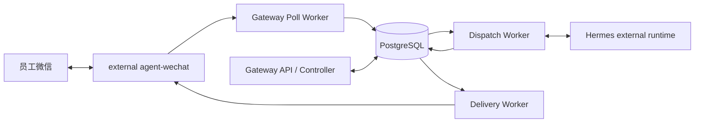
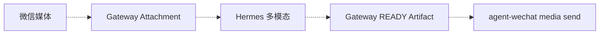

# 微信入口与 Hermes 集成架构

> 需求同步日期：2026-10-20；历史实机证据保留原日期，本轮未访问生产或正式 Hermes。

## 当前集成

agent-wechat 与 Gateway 通过 `cf-internal` 和 Token contract 通信。Hermes 在目标 AI 电脑；现有 Gateway 保存/选择 `external_profile_ref`、版本并随请求传递，这是引用和续接基础。D026“只引用、Hermes 自行管理”是历史边界；最新方向为 Gateway 通过官方受控能力编排独立 Profile 创建与同步，可行性待验证。请求字段存在不证明真实路由、创建、同步或已有会话配置生效已接通。

整体业务目标继续为员工微信 → 微信入口 → Gateway 权限/上下文/任务 → 官方 Hermes 与工具 → 企业文件服务/后续业务系统 → 结果返回微信。按[最新确认](../requirements/confirmed-platform-scope.md)先完成四仓基础，具体业务理解和流程交后续 Hermes/Skills；Skills 在基础完成后另行制作并单独建仓库。AI 与员工共用 FileBrowser 唯一正式文件系统，文件按任务取得、按明确要求归档，见[文件业务需求](../requirements/file-workflows.md)。旺店通/S6 后续集成。

## 文本链路

1. Poll Worker 保存来源消息并形成 Admission。
2. Allowed 后建立 V2 AI Thread、Route snapshot 和 durable Dispatch。
3. Dispatch Worker 调用 Hermes。
4. Gateway 持久化 Response 并创建 Delivery Outbox。
5. Delivery Worker 通过 agent-wechat 返回原会话。

私聊与真正 `@` 的群聊文本有历史生产闭环；未 `@` 普通群消息不会调用 Hermes。[2026-09-17 长任务回传](../validation/records/2026-09-17-gateway-long-task-acceptance.md)补充了分钟级文本任务的限定成功，不能扩大为文件/图片实收或当前在线状态。

## Thread 边界

V2 `group_sender` 包含 sender identity，并已由代码测试覆盖。同群多发送者尚缺真实生产对照证据。V1 compatibility path 的 whole-room thread 不能作为当前 V2 策略。

最新 B 方案：员工/群各自独立真实 Hermes Profile，同组共享模板而非 Profile 状态；群按群分组，发起者仍须获准。每个私聊/群对应会话首次建立后持续续接。现有 `group_sender` 和 revision 改键与该新目标有差距，不能将旧隔离实现当作已完成。授权可未分组，不暗配默认档案；Profile 独立不等于系统沙箱，文件授权仍由服务端执行。

同步只更新管理员明确模板字段，不覆盖历史、记忆、运行状态或独立凭据。创建时机、模板字段、调组历史处理及已有会话是否需新轮次/重载待细化/验证；状态、版本、失败和生效时机需可见。

## Context 与恢复

Gateway Context Runtime 已实现线程 Timeline、Snapshot 和 search。Admin API 已实现 `uncertain` inspection 与受控恢复。它们有仓库/CI证据并随 Release 部署，但完整生产动作覆盖仍需留证。

当前 FIFO 和会话续接不能证明运行中补充已接通；补充应进入对应正在执行的过程，须与独立新请求、动作结束后修改分开。当前群近几条上文、明确引用、日期范围是基础需求，现有 Context 只读取成功 Dispatch/Response，不能等同全部 Message 档案；人工 Web 和受控机器人查询应使用同一档案。self 跳过等采集缺口继续保留，详见[系统设计](../02_系统设计.md)。

Hermes 不可达时不得盲重试；已有一次受控恢复成功。AI host reboot 后 reachability 曾恢复，不代表 watchdog 和告警全部交付。

## Session 与发布

最后实际现场观察为 2026-10-19 北京时间 18:36，固定于[10 月 20 日证据摘要](../validation/records/2026-10-20-overall-status-evidence.md)；[10 月 11 日旧断点](../validation/records/2026-10-11-overall-status-evidence.md)保留历史，不作为本轮待执行步骤。PR12 后续官方 Hermes/纯配置实验见[固定候选记录](../validation/records/2026-10-20-configuration-only-candidate.md)，不等于生产迁移或新机证明完成。

以下是已有运行契约；最新后置恢复目标要求在线保留微信登录、离线再提示扫码，二者存在冲突，尚未通过新目标验收。本轮不修改或执行脚本。

- CFserver/agent-wechat restart 需要 fresh QR。
- AI host reboot 通常不需要 fresh QR。
- Gateway-only deployment 不重建 agent-wechat，也不需要 fresh QR。
- fresh QR 前必须通过 Controller `stop` 关闭组合 Poll/Delivery Gate；验证后 `start` 同时恢复 Poll/Delivery。Dispatch Worker 由 Gateway Release/Compose 生命周期独立管理；automatic boot stop gate 未验证。

## 媒体与文件

虚线表示完整范围仍需分项验收，不能抹去 PDF/PNG 样本及正常 ZIP 出站的真实验收、单商品归档、受限操作及既有隔离测试。正式归档必须经 `CF_filebrowser-enterprise` API、权限和审计；Hermes/Gateway 不得挂载正式目录绕过 File Service。

微信取得原件、理解、按要求保存、独立检索交付、加工回存分别按[验收清单 B11](../validation/production-validation-checklist.md#b11-媒体文件和业务扩展)留证。元数据留档、任务取件和正式归档不绑定；普通附件无任务一般不处理/回复。ZIP 入站和合法原文件名实际协议部署/收件仍有缺口，PNG 原字节差异已不阻塞。

Gateway Web 的权限、分组、模板/Profile/目标电脑、登录和三类运行状态、档案、电脑资源/任务、频率七项规划见[权威正文](../requirements/confirmed-platform-scope.md)，数据库/读取 API、缺写接口、缺采集和未有页面分别记录。分组手工明确分机、不预设台数和自动迁移；简部署与统一恢复入口后置，原六阶段不变。

当前状态见[状态矩阵](../status/current-status.md)。
