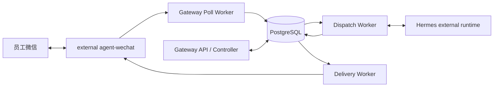
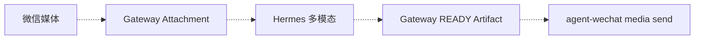

# 微信入口与 Hermes 集成架构

> 状态日期：2026-10-11；结构沿用既有职责，历史实机证据保留原日期。

## 当前集成

agent-wechat 与 Gateway 通过 `cf-internal` 和 Token contract 通信。Hermes 在 Windows AI 主机，Gateway 不创建 Hermes Profile，只保存和选择 `external_profile_ref`。

整体业务目标继续为员工微信 → 微信入口 → Gateway 权限/上下文/任务 → 官方 Hermes 与工具 → 企业文件服务/后续业务系统 → 结果返回微信。AI 与员工共用 FileBrowser 唯一正式文件系统；内容分类、指定目录归档、查找回传、工作副本加工后 API 回存沿用[9 月 27 日文件业务需求](../requirements/file-workflows.md)。旺店通/S6 仍为后续集成。

## 文本链路

1. Poll Worker 保存来源消息并形成 Admission。
2. Allowed 后建立 V2 AI Thread、Route snapshot 和 durable Dispatch。
3. Dispatch Worker 调用 Hermes。
4. Gateway 持久化 Response 并创建 Delivery Outbox。
5. Delivery Worker 通过 agent-wechat 返回原会话。

私聊与真正 `@` 的群聊文本有历史生产闭环；未 `@` 普通群消息不会调用 Hermes。[2026-09-17 长任务回传](../validation/records/2026-09-17-gateway-long-task-acceptance.md)补充了分钟级文本任务的限定成功，不能扩大为文件/图片实收或当前在线状态。

## Thread 边界

V2 `group_sender` 包含 sender identity，并已由代码测试覆盖。同群多发送者尚缺真实生产对照证据。V1 compatibility path 的 whole-room thread 不能作为当前 V2 策略。

## Context 与恢复

Gateway Context Runtime 已实现线程 Timeline、Snapshot 和 search。Admin API 已实现 `uncertain` inspection 与受控恢复。它们有仓库/CI证据并随 Release 部署，但完整生产动作覆盖仍需留证。

Hermes 不可达时不得盲重试；已有一次受控恢复成功。AI host reboot 后 reachability 曾恢复，不代表 watchdog 和告警全部交付。

## Session 与发布

2026-10-11 用户回传新候选与两端新 plan 通过但尚未切换，之后已重启 CFserver；重启后状态未知、Windows 是否关机未确认。下一步先核验现场和现存计划，符合条件再接续；本次不执行切换或恢复。版本和截止点统一见[10 月 11 日证据摘要](../validation/records/2026-10-11-overall-status-evidence.md)。

- CFserver/agent-wechat restart 需要 fresh QR。
- AI host reboot 通常不需要 fresh QR。
- Gateway-only deployment 不重建 agent-wechat，也不需要 fresh QR。
- fresh QR 前必须通过 Controller `stop` 关闭组合 Poll/Delivery Gate；验证后 `start` 同时恢复 Poll/Delivery。Dispatch Worker 由 Gateway Release/Compose 生命周期独立管理；automatic boot stop gate 未验证。

## 媒体与文件

虚线表示完整链路尚未通过系统级业务验收，不能据此抹去已有代码、隔离测试及局部部署证据。正式归档必须经 `CF_filebrowser-enterprise` API、权限和审计；已有受限读取和受控文本新建不证明真实附件业务闭环，Hermes/Gateway 不得直接挂载正式目录绕过 File Service。

微信入站取得字节、内容理解、指定目录/分类归档、文件中心查询回传、原聊天实际附件实收、加工结果回存分别按[验收清单 B11](../validation/production-validation-checklist.md#b11-媒体文件和业务扩展)留证。当前先交付真实文件/图片收发，暂不并行扩安装器或大重构。轻量 Gateway Web 仅待规划，限 Gateway 权限及已接收的部分聊天/任务记录，不承诺完整微信历史，也不复制 FileBrowser 文件权限体系。

当前状态见[状态矩阵](../status/current-status.md)。
